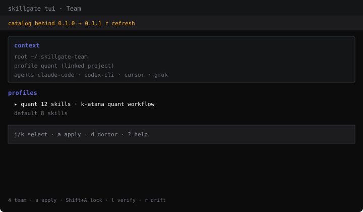

<div align="center">


# Skillgate Team

<p>
  <strong>简体中文</strong> · <a href="README.en.md">English</a>
</p>

**团队 Agent Skills 目录。一个 Git 仓库，同步到 Codex CLI 与全系 Agent。**

[](VERSION)
[](package.json)
[](package.json)
[](cli/package.json)
[](#开发)

[安装](#安装) · [能干什么](#能干什么) · [界面](#界面长什么样) · [上手](docs/GETTING_STARTED.md) · [提 Issue](https://github.com/2233admin/skillgate-team/issues/new/choose)

</div>

每人本机的 `~/.codex/skills`、`~/.claude/skills` 各装各的——版本对不上、新人不知道装什么，是团队里最常见的问题。

Skillgate Team 把技能收进**一个 Git 仓库**。维护者改 `profiles/`，成员 `git pull` 后 Apply，本机 **Codex CLI**、Claude Code、Cursor、Grok 四个目录对齐同一套清单。不用在群里追问「谁没更新 skill」。

---

## 安装

```bash
git clone https://github.com/2233admin/skillgate-team.git ~/.skillgate-team
cd ~/.skillgate-team

bun install --ignore-scripts
bun run build
bun run install-global
```

Windows 桌面版：`bun run gui:install`  
环境：**Bun** + **Node 22–25**（Node 26 与 SQLite 不兼容）。

装完应用默认 profile：

```bash
skillgate apply --profile quant -y
skillgate doctor --profile quant
```

Codex CLI 技能目录：`~/.codex/skills`（或 `$CODEX_HOME/skills`）。

---

## 能干什么

<p align="center">
  
</p>

#### 团队目录 — 单一事实源

`skills/` 放技能本体，`profiles/` 定义装什么，`skills.lock.yaml` 钉死每个文件的哈希。内容被悄悄改过，Doctor 和 lock verify 会标出来。

#### Profile — 一条 YAML 管全队

默认 [`quant`](profiles/quant.yaml)：**12 个技能**，下发到 **Codex CLI / Claude Code / Cursor / Grok**。日常使用者选好 profile 点 Apply；维护者才改 YAML。

#### Apply · Doctor · Lock — 同步与自检

- **Apply**：按 profile 链到本机 Agent 目录；[`protect.yaml`](protect.yaml) 中的条目不会被覆盖
- **Doctor**：对比本机安装与 profile，列出缺失与漂移
- **Lock verify**：磁盘内容与 lock 哈希是否一致；维护者 `--write` 后提交
- **Catalog drift**：远程 `VERSION` 更新时，Desktop / TUI 顶部提示 `git pull`

#### Desktop · TUI · CLI — 同一套 `team-api`

`skillgate gui` · `skillgate tui`（`4` 进 Team）· `skillgate apply --profile quant -y`  
三端共用 `cli/src/team-api/`，行为一致。

#### team-init — 绑到业务仓库

`skillgate team-init --mode required` 生成 `.skillgate/profile`；Desktop **Linked project** 可自动读取。

### 默认 profile：`quant` 技能一览

面向量化 / 全栈工程。12 技能 × 4 Agent。清单见 [`profiles/quant.yaml`](profiles/quant.yaml)。

#### coding-standards — 编码底线

命名、可读性、不可变数据；框架细节交给 frontend / backend 技能。

#### frontend-patterns — React / Next 前端

状态、性能、组件拆分——写 UI 时统一约定。

#### nextjs-turbopack — Next.js 16+ 与 Turbopack

增量打包、dev 速度；Turbopack 与 webpack 的取舍。

#### backend-patterns — 后端架构

Node / Express / Next API routes 的分层与常见坑。

#### api-design — REST API 设计

资源命名、状态码、分页、错误体、版本与限流。

#### security-review — 安全审查

鉴权、输入、密钥、支付路径——改动时拉 checklist。

#### tdd-workflow — 测试驱动

新功能 / 修 bug / 重构：先测后写，目标 80%+ 覆盖。

#### e2e-testing — Playwright E2E

Page Object、CI、产物与 flaky 处理。

#### verification-loop — 会话级验收

大任务分阶段验证，避免「改完没跑通」。

#### documentation-lookup — 查现行文档

Context7 MCP 拉库文档，避免过期 API。

#### deep-research — 多源调研

搜索、交叉验证、引用来源。

#### strategic-compact — 手动压缩上下文

在逻辑断点 compact，减少半路截断。

---

## 界面长什么样

> 示意图，布局与真机一致。实拍见 [docs/SCREENSHOTS.md](docs/SCREENSHOTS.md)。

<table>
<tr>
<td width="58%">

**Desktop**

设置 **Team catalog root** → 选 profile → Apply → Doctor。

<p align="center">
  
</p>

</td>
<td width="42%">

**TUI**

`skillgate tui` → `4` → `a` 应用 → `d` 自检。

<p align="center">
  
</p>

</td>
</tr>
</table>

---

## 第一次用

1. `skillgate gui` 或 `skillgate tui`
2. **设置** → **Team catalog root** = clone 路径
3. **Team** → `quant` → **Apply** → **Doctor**

`bun run smoke-team`（15 项）。详细路径见 [docs/GETTING_STARTED.md](docs/GETTING_STARTED.md)。

---

## 常见问题

**Team 页「目录不可用」？**  
**Team catalog root** 路径错误或不存在；或设置 `SKILLGATE_ROOT`。

**Desktop 起不来？**  
确认 Node 22–25，`bun run gui:install`。

**维护者更新了技能？**  
`git pull` → **Apply**；维护者 `skillgate lock verify --write` 并提交 lock。

---

## 仓库地图

| 路径 | 内容 |
|------|------|
| [`skills/`](skills/) | 团队 vendored 技能 |
| [`profiles/`](profiles/) | Profile 定义 |
| [`skills.lock.yaml`](skills.lock.yaml) | 内容哈希锁定 |
| [`cli/`](cli/) | `skillgate` CLI + `team-api` |
| [`desktop/`](desktop/) | Electron 桌面（默认中文界面，可切英文） |
| [`tui/`](tui/) | OpenTUI 终端 UI |
| [`docs/DESIGN.md`](docs/DESIGN.md) | 视觉系统 |
| [`docs/images/`](docs/images/) | 配图 |

---

## 开发

```bash
bun install --ignore-scripts
bun run test
bun run build
bun run graph
```

提 PR 前见 [CONTRIBUTING.md](CONTRIBUTING.md)。