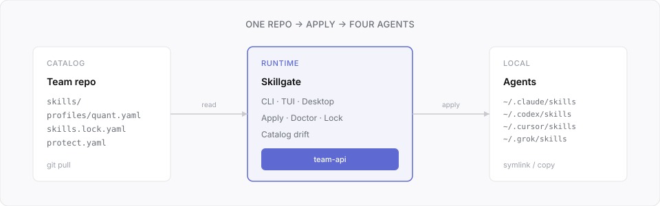

# 第一次上手

配合 [README](../README.md) 用。clone 完仓库，下面三条路选一条走到底。

<p align="center">
  
</p>

---

## 先弄清五个词

不用背定义，知道谁管啥就行：

- **团队目录** — 就是这个仓库（`skills/`、`profiles/`、`skills.lock.yaml`）
- **Profile** — 一份 YAML，写死装哪些技能、发给哪些 Agent；默认 `quant`
- **Apply** — 按 profile 把技能链到本机 `~/.claude/skills` 等目录
- **Doctor** — 看本机实际安装和 profile 差在哪
- **Lock** — `skills.lock.yaml` 里的哈希；目录被人悄悄改过，verify 会对不上

日常使用者：**选 profile → Apply → 完事**。维护者才需要动 YAML 和 lock。

---

## 路径 A：桌面版

### 准备

[Bun](https://bun.sh) + **Node 22 或 25**（不要用 26）。仓库 clone 到固定位置，例如：

- macOS / Linux：`~/.skillgate-team`
- Windows：`D:\skillgate-team`（路径别带中文空格，设置里要原样填）

### 安装

```powershell
# Windows
bun install --ignore-scripts
bun run build
bun run gui:install
bun run install-global
```

```bash
# macOS / Linux
bun install --ignore-scripts
bun run build
bun run install-global
# 桌面版依赖按 README 补装
```

### 打开后做什么

```bash
skillgate gui
```

1. **设置** → **Team catalog root** 填 clone 路径  
2. （可选）**Linked project** 填业务仓库，自动读 `.skillgate/profile`  
3. 侧边栏 **Team** → 选 `quant` → **Apply profile** → 确认  
4. **Run doctor**，无漂移就 OK  

顶部黄色横幅「目录可能落后」→ 先 `git pull`，再 Apply。

---

## 路径 B：终端 UI

```bash
skillgate tui
```

| 键 | 作用 |
|----|------|
| `4` | Team |
| `j` / `k` | 选 profile |
| `a` | Apply |
| `d` | Doctor |
| `l` | 验证 lock |
| `r` | 刷新目录漂移 |
| `s` | 设置 team.root |
| `?` | 快捷键表 |

报错「目录不可用」→ 按 `s`，把 **team.root** 设成仓库路径。

---

## 路径 C：纯命令行

```bash
export SKILLGATE_ROOT=~/.skillgate-team   # Windows: set SKILLGATE_ROOT=D:\skillgate-team

skillgate apply --profile quant -y
skillgate doctor --profile quant
skillgate lock verify
skillgate smoke-test
```

绑业务项目：

```bash
cd ~/projects/my-app
skillgate team-init --mode required
```

---

## `quant` profile 里有什么

默认装 **12 个技能** × **4 个 Agent**（claude-code、codex-cli、cursor、grok）。

每个技能干什么、按什么场景触发——README 里有一览表（`#### 技能名 — 一句话` 那种，写法跟 [huashu-skills](https://github.com/alchaincyf/huashu-skills) 一样）。YAML 源文件：[profiles/quant.yaml](../profiles/quant.yaml)。

团队要换清单：改 `profiles/*.yaml` → `skillgate lock verify --write` → 提交 → 成员 `git pull` 再 Apply。

---

## 目录落后了怎么办

1. 团队目录 `git pull`
2. Team 页看横幅里的本地 / 远程版本号
3. 再 **Apply** 一次
4. 维护者：`skillgate lock verify --write` 后提交 lock

`team-init --mode required` 还会在 Claude Code 启动时提示 `TEAM_CATALOG_UPGRADE`。

---

## 验证装对了没

```bash
bun run smoke-team
```

应过 15 项（context、profiles、drift、doctor 等）。

---

## 还是卡住

用 **[求助模板](https://github.com/2233admin/skillgate-team/issues/new?template=help_request.yml)** 发帖，这几项贴全：

- 系统 + Node / Bun 版本
- 用的 CLI / TUI / Desktop 哪一个
- **Team catalog root** 填的路径
- 完整报错或截图